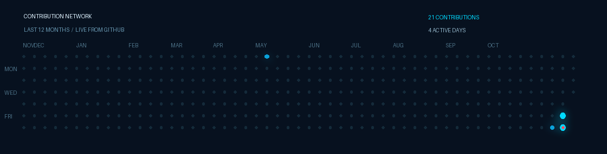

ضع الجزء ده داخل README تحت عنوان Contribution Activity، وخلي صورة الـ Snake القديمة بعده زي ما هي:

```html
<div align="center">
  
  <br/><br/>
  
</div>
```

الـ GIF تُولّد من Contribution Calendar الحقيقي لحساب `mohamed1-0`، وتتحدث يوميًا عن طريق GitHub Actions.
